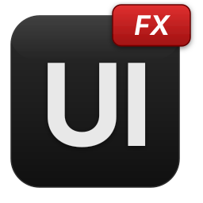
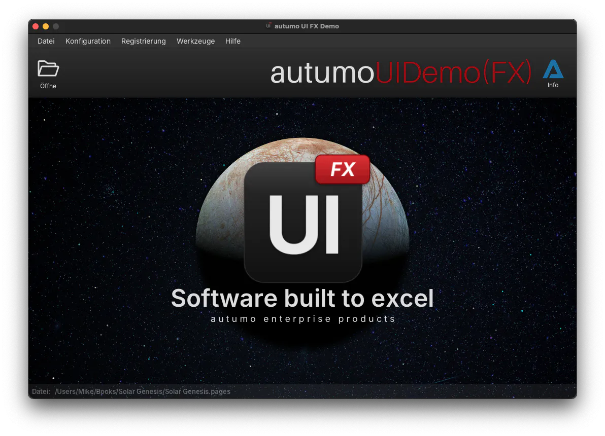

  

<h1 align="center" style="font-size: 3.5em; margin: 0">autumo UI FX Demo</h1>
 

## autumo UI FX Demo

This project demonstrates a sample JavaFX application built with the **autumo UI FX** framework, an open-source framework for rapid JavaFX application development.

A separate **commercial version** of the framework is also available. It can be integrated into application licensing platforms and provides an extended set of components and tools for general-purpose JavaFX desktop application development.

The **autumo UI FX** framework is available here:

[https://github.com/autumoswitzerland/autumo-ui-fx](https://github.com/autumoswitzerland/autumo-ui-fx)

  

 

---

Copyright &copy; 2026 autumo GmbH. All rights reserved.

